# Active Directory Lab

A hands-on Active Directory lab in VirtualBox: a Windows Server domain controller, a domain-joined Windows 11 client, users created with PowerShell, a password policy, and a Group Policy screen lock.

## Overview

- Domain controller for `corp.testlab.local` on Windows Server
- Windows 11 client joined to the domain
- Four users created with PowerShell, grouped in a `Trainees` security group
- Fine-grained password policy for the group
- Group Policy Object enforcing a password-protected screen saver (created in Group Policy Management)

## Environment

| Item | Details |
|---|---|
| Virtualization | Oracle VirtualBox |
| Server | Windows Server (domain controller) |
| Client | Windows 11 |
| Tools | PowerShell, Group Policy Management |

## Configuration

| Setting | Value |
|---|---|
| Users | Trainee25, Billa, Jack, Client1 |
| Group | Trainees |
| Minimum password length | 12 characters, complexity on |
| Account lockout | 4 failed attempts, locked for 20 minutes |
| Screen saver lock (GPO) | 600 seconds (10 minutes) |

## Scripts

Run these in order on the domain controller, in an elevated PowerShell session.

| Script | What it does |
|---|---|
| [`01-create-users.ps1`](scripts/01-create-users.ps1) | Creates the four user accounts (prompts for a lab password) |
| [`02-create-group.ps1`](scripts/02-create-group.ps1) | Creates the `Trainees` security group and adds the users |
| [`03-apply-password-policy.ps1`](scripts/03-apply-password-policy.ps1) | Applies the fine-grained password policy to the group, minimum length 12 |
| [`04-verify.ps1`](scripts/04-verify.ps1) | Checks users, group, effective password policy, and applied Group Policy |

The `Policy for Trainee` settings object is created beforehand. The Group Policy Object is created in Group Policy Management.

## Verification

`Get-ADUserResultantPasswordPolicy` confirmed the policy applied through the `Trainees` group. After `gpupdate /force`, `gpresult /r /scope user` listed the GPO under the user's applied policies.

## Troubleshooting Notes

- **VirtualBox setup error** ("Windows cannot find the Microsoft Software License Terms"): skip unattended install and check the ISO. This is a common issue that occurs
- **"Cannot find an object with identity":** Create your users first like I did then find the object with identity
- **GPO not showing in `gpresult`:** it needed `gpupdate /force` to refresh like a complete force to fix it

## Key Takeaway

Password rules come from a fine-grained password policy, while the screen lock comes from a Group Policy Object. Seperate features but I verified it before hand

## Screenshots

**Build and verification**

| | |
|---|---|
| Users, group, and policy commands (password blurred) | 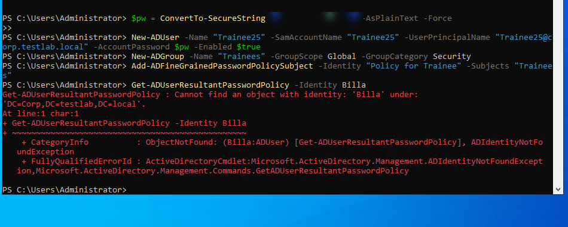 |
| Effective password policy for a user | 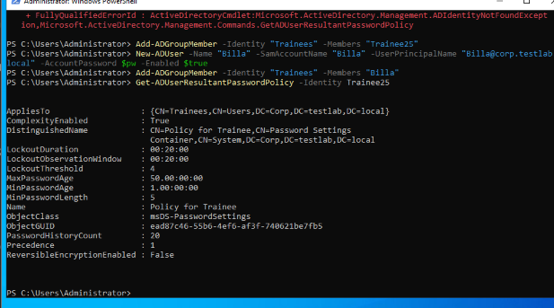 |
| Minimum length set to 12, complexity on | 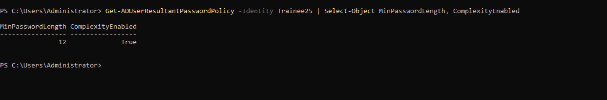 |
| Lockout settings | 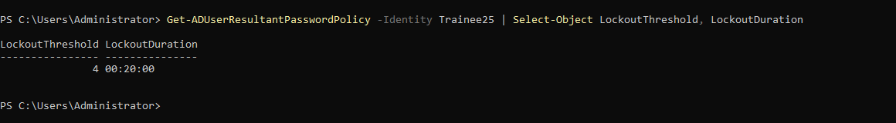 |
| Users and group membership | 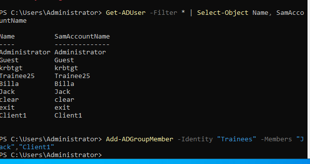 |
| GPO linked to the domain | 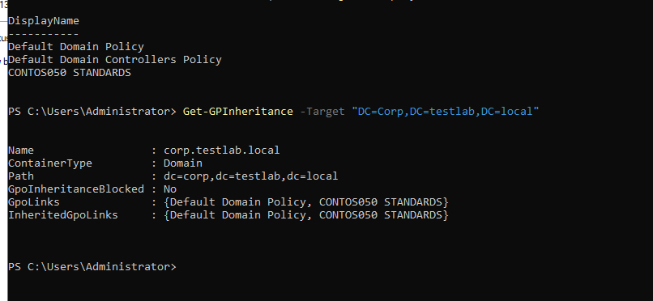 |
| GPO permissions | 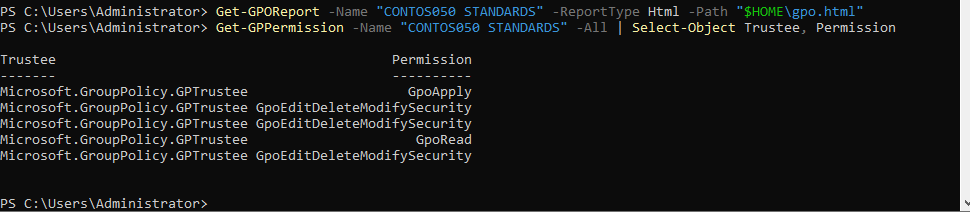 |
| `gpresult` showing the GPO applied | 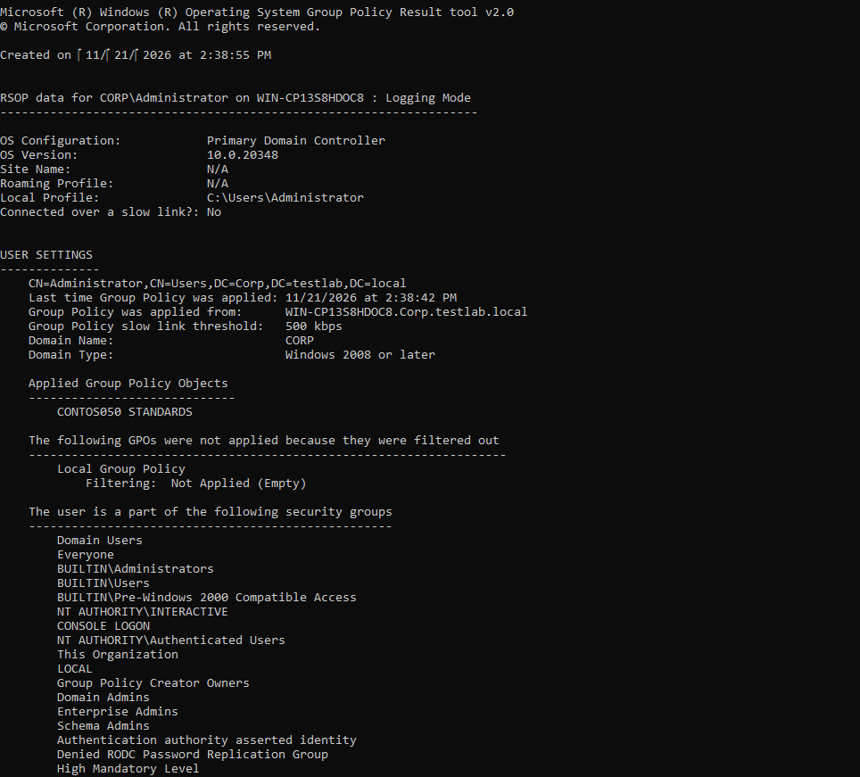 |

**Debugging**

| | |
|---|---|
| VirtualBox setup error | 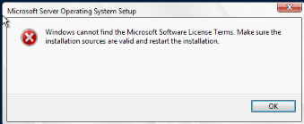 |
| Only built-in accounts existed | 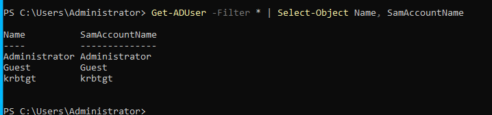 |
| Policy subject not found | 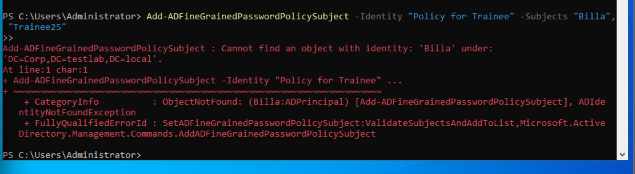 |
| Command broken by a line break | 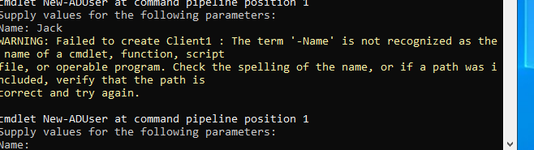 |
| `gpresult` before refresh (computer) | 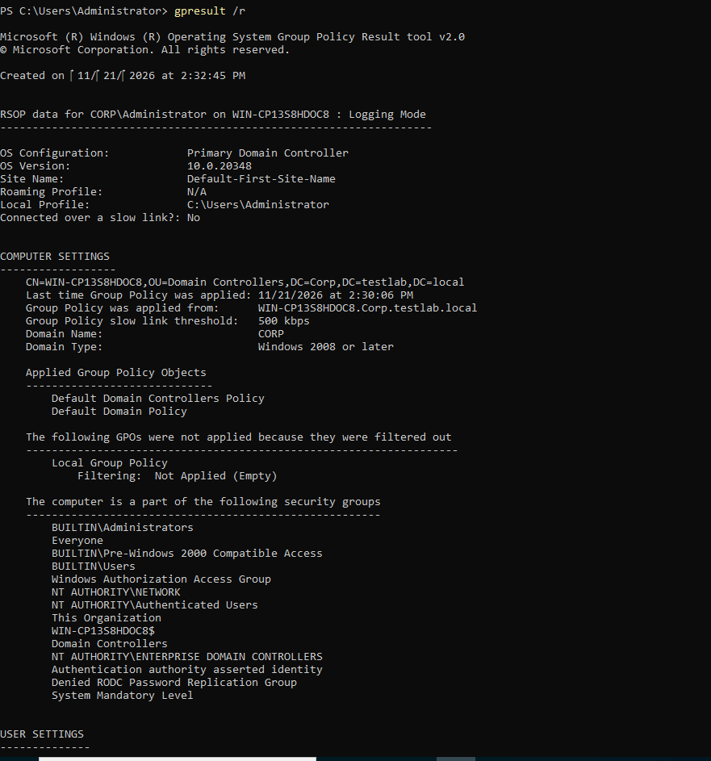 |
| `gpresult` before refresh (user) | 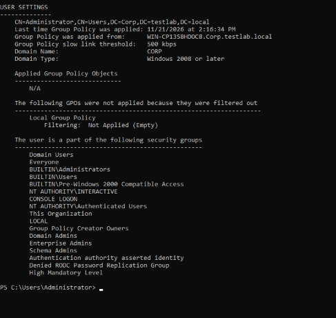 |
